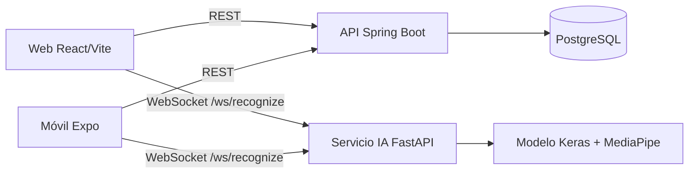

# One Language — Documentación técnica

Repositorio documental del proyecto formativo **One Language**, SENA — Tecnólogo en Análisis y Desarrollo de Software (ADSO), ficha 3145555.

One Language busca apoyar interacciones comunicativas básicas entre personas usuarias de Lengua de Señas Colombiana (LSC) y personas que no la conocen. Reconoce únicamente el conjunto limitado de señas con el que se entrenó el modelo; presenta el resultado como texto y permite su reproducción en audio. No interpreta conversaciones completas, no reconoce toda la LSC y no sustituye a intérpretes profesionales.

## Estado de esta documentación

El contenido se basa en el SRS y artefactos internos disponibles en Drive, y en la inspección de las ramas `dev` (web, backend y base de datos) y `develop` (IA) el 22 de octubre de 2026. Los estados utilizados son **Implementado funcionalmente**, **Implementado e integrado**, **Implementado y verificado**, **Implementado, pendiente de validación en ejecución**, **Especificado** y **Pendiente de implementación**. Consulte la [auditoría de fuentes](docs/source-audit.md) antes de usar esta documentación para despliegue.

## Componentes verificados

| Componente | Tecnología confirmada | Repositorio / rama |
| --- | --- | --- |
| Cliente web | React 19, Vite 8, React Router, Axios | [OneLanguage_Frontend](https://github.com/JohanAceroSalazar/OneLanguage_Frontend/tree/dev) |
| Cliente móvil | React Native, Expo Router, Expo Camera, Expo Speech | mismo repositorio, `mobile/` |
| API | Java 17, Spring Boot, JPA, Spring Security, JWT | [OneLanguage-Backend](https://github.com/JohanAceroSalazar/OneLanguage-Backend/tree/dev) |
| Datos | PostgreSQL, Liquibase YAML/SQL, Docker Compose | [OneLanguage-Database](https://github.com/JohanAceroSalazar/OneLanguage-Database/tree/dev) |
| IA | Python, TensorFlow/Keras, MediaPipe, OpenCV, FastAPI | [OneLanguage-AI](https://github.com/Juan282007/OneLanguage-AI/tree/develop) |

## Navegación

| Área | Contenido |
| --- | --- |
| [SRS](docs/01-srs/README.md) | Requisitos, criterios y trazabilidad |
| [Producto](docs/02-product/README.md) | Visión, glosario, backlog e historias |
| [Diseño](docs/03-design/README.md) | Casos de uso y diagramas |
| [Arquitectura](docs/04-architecture/README.md) | Componentes, decisiones y datos |
| [Web](docs/05-web/README.md) · [Móvil](docs/06-mobile/README.md) · [Backend](docs/07-backend/README.md) | Implementación por frente |
| [Desarrollo](docs/08-development/README.md) · [Despliegue](docs/09-deployment/README.md) | Guías operativas |
| [IA](docs/10-artificial-intelligence/README.md) · [Calidad](docs/11-quality/README.md) | Modelo, pruebas y riesgos |

## Inicio local

Las instrucciones y puertos observados están en [instalación](docs/09-deployment/installation.md). La ejecución conjunta está implementada mediante contratos entre componentes y requiere validación en el ambiente objetivo. No se deben versionar credenciales, claves JWT ni archivos `.env` reales.

## Equipo

- Johan Alexander Acero Salazar
- Juan Pablo Gómez Perdomo

Consulte [CONTRIBUTING.md](CONTRIBUTING.md) para contribuir. No se ha encontrado una licencia explícita en las fuentes auditadas.
