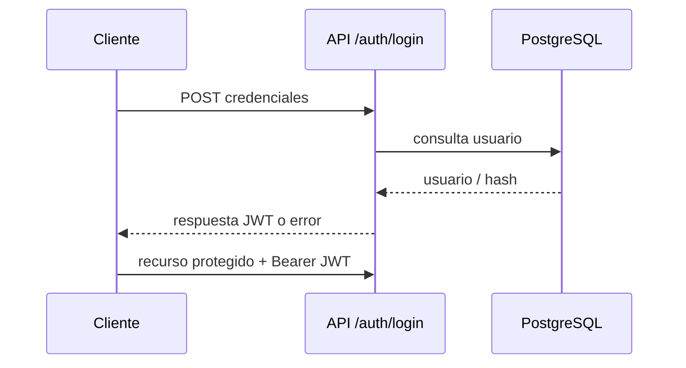

# Integración de componentes

| Integración | Mecanismo evidenciado | Estado |
| --- | --- | --- |
| Web/Móvil ↔ API | Axios/fetch, servicios y controladores REST | Implementado e integrado |
| API ↔ PostgreSQL | Spring Data JPA, entidades y DDL versionado | Implementado e integrado |
| Cliente ↔ IA | WebSocket `/ws/recognize`; clientes envían frames y procesan mensajes de predicción | Implementado e integrado; pendiente de validación en ejecución |
| IA ↔ cámara | frames JPEG decodificados en WebSocket; cámara local en herramientas IA | Implementado en componentes separados |
| Resultado ↔ historial | API translations y pantallas History | Implementado e integrado; flujo completo desde reconocimiento pendiente de validación en ejecución |

Secuencia prevista de autenticación:

