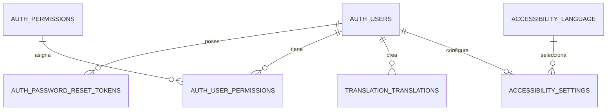

# Diccionario de datos y esquema

El changelog vigente crea y altera el siguiente esquema objetivo: `auth.users`, `auth.password_reset_tokens`, `auth.permissions`, `auth.user_permissions`, `translation.translations`, `accessibility.language` y `accessibility.accessibility_settings`.

Las alteraciones vigentes trasladan usuarios y tokens a `auth`; eliminan `auth.sessions`; restauran `auth.permissions` y `auth.user_permissions`; eliminan el permiso `files` y conservan `camera`/`audio`; agregan a `translation.translations` los metadatos `recording_path`, `recording_content_type` y `recording_size`; y eliminan `translation.signs`, `translation.translation_signs` y `translation.audio_files`. Esta conclusión describe el orden completo de changelogs, no la verificación de una instancia desplegada.

La relación de grabación ya no se modela mediante `audio_files`: la tabla `translations` almacena sus metadatos y el archivo vive en almacenamiento configurado por backend. La fuente de verdad de cada ambiente sigue siendo `DATABASECHANGELOG` de Liquibase.
