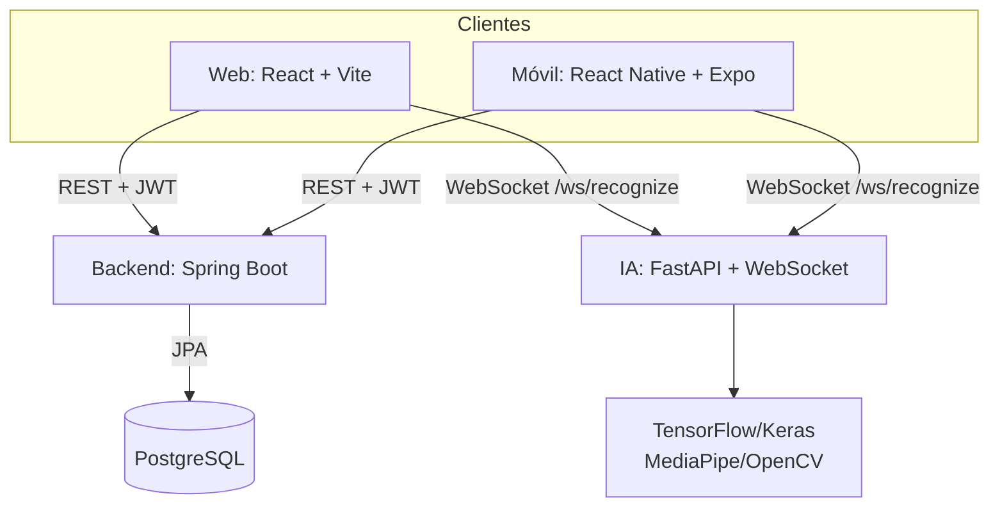

# Arquitectura general

**IMPLEMENTADO E INTEGRADO:** dos clientes, una API REST Spring Boot, PostgreSQL versionado y un servicio Python FastAPI/WebSocket. Los contratos REST y WebSocket están implementados entre los componentes; la validación de una ejecución conjunta en el ambiente objetivo sigue pendiente.

La API administra usuarios, autenticación, recuperación de contraseña, accesibilidad, permisos y traducciones. Los clientes implementan el contrato WebSocket `/ws/recognize` contra IA. El servicio carga `model/lsc_sequence_model.keras` y `model/lsc_labels.json`; esos artefactos no están en el clon auditado. La operación conjunta no se ejecutó.
